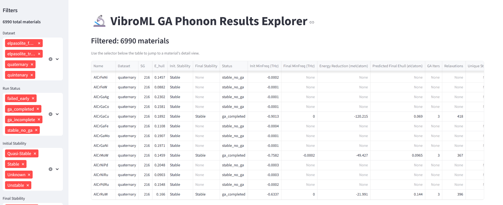
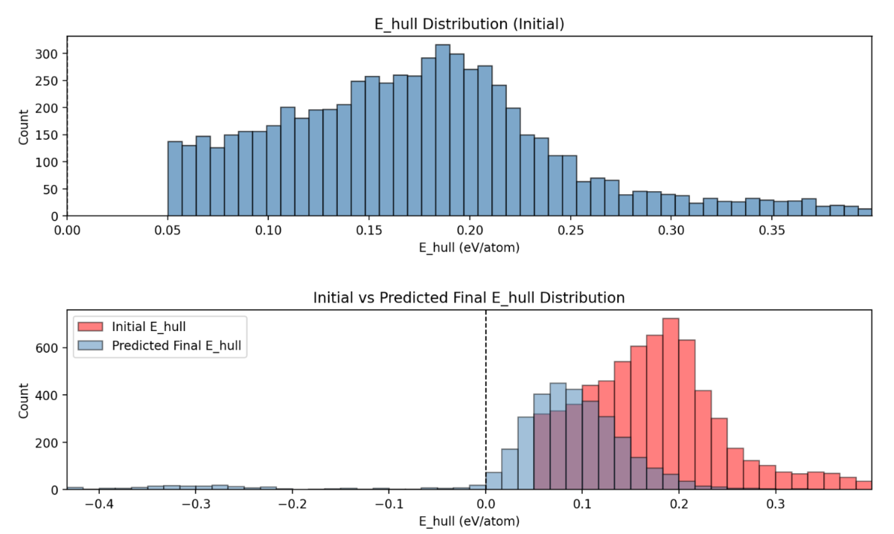

# VibroML Support Data

Supporting data for the manuscript *"VibroML: an automated toolkit for
high-throughput vibrational analysis and dynamic instability remediation of
crystalline materials using machine-learned potentials"*.

- **VibroML**: https://github.com/rogeriog/VibroML
- **ProtoCSP**: https://github.com/rogeriog/ProtoCSP
- **Figshare deposit** (GA local-minima XYZ dataset and explorer database
  bundle): https://doi.org/10.6084/m9.figshare.34790283

## Interactive database explorer

A Streamlit application for browsing all 6,990 remediated systems: input and
optimized structures, GA populations, phonon band structures, densities of
states, and phonon-mode animations.





<video src="https://github.com/rogeriog/VibroML_SupportData/raw/master/Recording_VibroML_explorer.mp4"
       controls muted style="max-width: 100%;"></video>

[Watch the explorer demo](Recording_VibroML_explorer.mp4)

### Quick start

```bash
git clone https://github.com/rogeriog/VibroML_SupportData.git
cd VibroML_SupportData
python launch_explorer.py
```

The setup script decompresses the bundled metadata database, downloads the
phonon/structure bundle from Figshare (2.5 GB, or pass `--bundle <path>` for a
local copy), and starts the explorer. See
[`whitespace_data/README.md`](whitespace_data/README.md) for details and
options.

## Repository layout

| Directory | Contents |
|-----------|----------|
| [`whitespace_data/`](whitespace_data/) | SQLite database of 6,990 materials / 264,542 GA structures / 305,998 phonon modes, the Streamlit explorer, per-system GA summaries, elpasolite white-space data |
| [`b2_intermetallics/`](b2_intermetallics/) | Phonon metrics for the B2 intermetallic validation set (CuN, ZnCu, ZrCu across MACE-OMAT, eSEN, UMA) |
| [`LiF_anomaly_tests/`](LiF_anomaly_tests/) | MLIP-vs-DFT path analysis for the LiF transition-state anomaly |
| [`neb_results/`](neb_results/) | DFT and MLIP NEB barriers and image data for the benchmark compounds |
| [`phonon_and_md_benchmarking/`](phonon_and_md_benchmarking/) | Phonon and molecular-dynamics evaluation summaries across all engines |
| [`remediation_results/`](remediation_results/) | Unique-structure compilations, timing, and stability-remediation outputs for the benchmark compounds |
